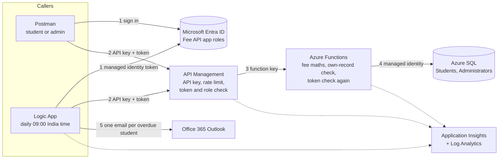

# Fee Management System

A cloud-native student fee system on Azure. Students check their own fee status through a secure API, administrators query and update fee records, and overdue students get an automatic email reminder every morning.

- **Azure SQL Database** holds the fee records (Students, Administrators).
- **Azure Functions** (TypeScript, Node 24) does the fee calculations and API logic.
- **API Management** exposes the API with API keys and rate limiting.
- **Microsoft Entra ID** signs everyone in; app roles (`Student`, `FeeAdmin`, `Reminders.Read`) decide what they may do.
- **Logic Apps** sends the reminders through **Office 365 Outlook**, with retry policies.
- **Application Insights** monitors all of it.

Everything is defined in this repository (Bicep, SQL scripts, policies, workflow, code) and deploys with the steps in [docs/DEPLOYMENT.md](docs/DEPLOYMENT.md).

## Architecture



A request passes through two independent checks. **API Management** rejects it unless it has a valid API key (401), is within the rate limit (429), carries an Entra ID token issued by this tenant for the Fee API (401) and holds the right role (403). The **Function** then verifies the token's signature itself (so a leaked function key alone is useless), checks the role again, and for a student compares the token's `oid` with the row's `EntraObjectId`. No component holds a password: the Function reaches SQL and Storage with its managed identity, and the Logic App reaches the API with its own.

## Requirements and where they are met

| Requirement | Implementation | Where |
|---|---|---|
| Azure SQL with Students (`StudentID, Name, Course, TotalFee, PaidAmount, DueDate`) and Administrators (`AdminID, Name, Role`) | Those columns, plus `Email` (reminders need an address) and `EntraObjectId` (links a row to a sign-in). CHECK constraints: no negative amounts, no overpayment, `Role = 'FeeAdmin'` | [sql/001_schema.sql](sql/001_schema.sql) |
| Sample data for at least 20 students | 20 hand-made students covering every status and the rounding edge cases | [sql/002_seed.sql](sql/002_seed.sql) |
| Handle at least 5,000 students efficiently | 5,000 generated students; covering index for the overdue query; paging (50) for lists; measured below | [sql/003_bulk_5000.sql](sql/003_bulk_5000.sql) |
| Azure Functions for fee calculations and API logic | All money maths in the Function, in whole paise; status `Paid` / `Partially Paid` / `Overdue` | [src/lib/fee.ts](src/lib/fee.ts), [src/functions](src/functions) |
| Fee details and payment status by StudentID | `GET /students/{id}/fees` | [src/functions/studentFees.ts](src/functions/studentFees.ts) |
| API Management with rate limiting and API keys | Consumption tier, product with two keys, 30 calls / 60 s per key | [infra/apim](infra/apim), [infra/gateway.bicep](infra/gateway.bicep) |
| Azure AD authentication and RBAC; students and administrators | App roles in Entra ID; checked by API Management and the Function; students see only their own record | [scripts/entra-setup.ps1](scripts/entra-setup.ps1), [src/lib/auth.ts](src/lib/auth.ts) |
| Admins query and update fee records securely | `GET /students`, `PATCH /students/{id}` (FeeAdmin role **and** a row in Administrators) | [src/functions/adminStudents.ts](src/functions/adminStudents.ts) |
| Logic App: fetch overdue students, send reminders with Outlook | Daily at 09:00 India time, calls `GET /reminders/overdue`, one Outlook email per student | [infra/logicapp/workflow.json](infra/logicapp/workflow.json) |
| Retry policies for Logic Apps | API call: fixed 30 s x 4 (covers the database waking up); email: fixed 60 s x 2 | [infra/logicapp/workflow.json](infra/logicapp/workflow.json) |
| Application Insights | Function, API Management and Logic App all log to one workspace; no personal data in logs | [infra/main.bicep](infra/main.bicep), [infra/gateway.bicep](infra/gateway.bicep), [src/lib/logger.ts](src/lib/logger.ts) |
| Scripts and configurations, architecture diagram, deployment guide | This repository, the diagram above, [docs/DEPLOYMENT.md](docs/DEPLOYMENT.md) | |

## API

Base URL: `https://apim-feemgmt-k7x2pq.azure-api.net/fees`. Every call needs the header `Ocp-Apim-Subscription-Key` and `Authorization: Bearer <Entra ID token for api://e0412180-09d9-4bd2-8480-bdecf8871490/access_as_user>`.

| Method and path | Role | Returns |
|---|---|---|
| `GET /students/{id}/fees` | `Student` (own record only) or `FeeAdmin` | name, course, `totalFee`, `paidAmount`, `balance`, `dueDate`, `status`, `asOf` |
| `GET /students?status=Overdue&page=1` | `FeeAdmin` | one page of 50, `total`, each with the same fields |
| `PATCH /students/{id}` body `{ "totalFee", "paidAmount", "dueDate" }` (any of them) | `FeeAdmin` | the updated record |
| `GET /reminders/overdue` | `Reminders.Read` (the Logic App only) | overdue students with email, balance and days overdue |
| `GET /api/health` (on the Function directly, no key) | anyone | `{ "status": "ok" }`; wakes a paused database |

```json
GET /students/1/fees
{ "studentId": 1, "name": "Rohan Kulkarni", "course": "B.Tech Computer Engineering",
  "totalFee": "120000.00", "paidAmount": "60000.00", "balance": "60000.00",
  "dueDate": "2026-09-30", "status": "Overdue", "asOf": "2026-10-14" }
```

| Status | Meaning |
|---|---|
| 400 | malformed input: bad id, unknown field, more than 2 decimal places, invalid date, broken JSON |
| 401 | no or wrong API key; no, expired or forged token |
| 403 | the token lacks the role, a student asks for someone else's record (or an id that does not exist, so ids cannot be probed), or an admin is not in the Administrators table |
| 404 | the student does not exist (administrators only) |
| 422 | `Overpayment`: `paidAmount` would exceed `totalFee` |
| 429 | more than 30 calls in 60 seconds with one API key (`Retry-After` says when to retry) |
| 503 | the database is waking from auto-pause; `Retry-After: 30` |

Amounts are returned as exact strings (`"10000.10"`). Error bodies from the Function have the form `{ "error", "message", "details"?, "correlationId" }`.

## Fee rules and assumptions

- **Status.** `Paid` when nothing is owed; otherwise `Overdue` if the due date is before today, else `Partially Paid` (this includes students who have paid nothing yet; the system has exactly these three statuses).
- **"Today" is the date in India** (`FEE_TIMEZONE = Asia/Kolkata`). The Function and the database run in UTC, which is still "yesterday" between 00:00 and 05:30 in India; the Function works out today's date and passes it to SQL, so the API and the reminders always agree.
- **Money is handled in whole paise.** JavaScript numbers are binary floats (`10000.10 - 10000.00 = 0.1000000000003638`), and the SQL driver returns `DECIMAL(10,2)` as a float, so each amount is converted to an integer once and back to an exact string once. Input with more than two decimals is rejected (SQL would silently round `1.005` to `1.01`).
- **No overpayment.** The system has no credits or refunds, so `paidAmount > totalFee` is refused (422), and a CHECK constraint enforces it in the database too.
- **Reminders go to overdue students only**, once a day at 09:00 India time. If more than 25 students are overdue, the workflow stops without sending anything, which protects the sending mailbox (Outlook allows 30 messages a minute).
- **Students have a login only when linked.** `EntraObjectId` is set for students who can sign in (here two invited guest accounts); the other sample students are records without a login.
- **Administrators** need the `FeeAdmin` role in Entra ID and a row in the Administrators table.

## Reliability

The database is serverless and pauses after 60 idle minutes; waking it took 74 seconds when measured. API Management's Consumption tier ends any request after 30 seconds, so the Function retries for at most 15 seconds and then answers `503` with `Retry-After: 30` while the database keeps waking. The Logic App retries every 30 seconds, four times. Call `GET https://func-feemgmt-k7x2pq.azurewebsites.net/api/health` once: it waits up to two minutes and wakes everything.

## Scalability (5,000+ students)

Measured on the deployed database with 5,020 students (the table occupies 118 pages):

| Query | Pages read |
|---|---|
| Overdue list (Logic App) | 3 |
| One student by id | 2 |
| One page of 50 for an admin | 4 |

Totals from the API add up: 4 overdue + 3,345 partially paid + 1,671 paid = 5,020.

Response times measured in Application Insights over a day of testing (successful calls):

| Endpoint | Calls | Median | 90th percentile |
|---|---|---|---|
| `GET /students/{id}/fees` | 36 | 20 ms | 1,276 ms |
| `GET /students` (page of 50) | 10 | 31 ms | 113 ms |
| `PATCH /students/{id}` | 15 | 28 ms | 1,179 ms |
| `GET /reminders/overdue` | 2 | 8 ms | 1,337 ms |

The Function itself answers in 20-30 ms; calls of 1-2 s are the first after the app has been idle (an instance starting). End to end through API Management, Postman measured 116 ms to 2.7 s (average 500 ms) for a run of ten requests.

## Monitoring

The Function, API Management and the Logic App all write to the workspace `log-feemgmt-k7x2pq` (30-day retention, 0.1 GB daily cap). Logs never contain names, emails, amounts, tokens or keys: the Function's logger only accepts fields such as `studentId` and `status`, and API Management logs no request or response bodies. Useful queries:

```kusto
AppRequests | summarize count() by Name, ResultCode          // calls by endpoint and status
AppTraces | where Message startswith "request."               // why requests were refused
AzureDiagnostics | where ResourceProvider == "MICROSOFT.LOGIC" // reminder workflow runs
```

## Testing

- `npm test`: 15 unit tests for the fee maths and input rules (Node's built-in test runner).
- [postman/fee-management.postman_collection.json](postman/fee-management.postman_collection.json): folders for the admin (10 requests, 20 assertions), a student (6), security (4), the rate limit, and running the reminders. All passed against the deployed system, the student folder as both guest accounts.
- The whole deployment was rehearsed from an empty resource group following [docs/DEPLOYMENT.md](docs/DEPLOYMENT.md), then deleted.

## Repository

```
infra/main.bicep          core: monitoring, storage, Function App, Azure SQL
infra/gateway.bicep       API Management and the reminder Logic App (deployed after the Function code)
infra/apim/*.xml          API Management policies (key, rate limit, token, roles)
infra/logicapp/workflow.json  reminder workflow
scripts/entra-setup.ps1   app registrations, roles and role assignments
scripts/deploy.mjs        builds and publishes the Function code (npm run deploy)
sql/001-006               schema, seed, 5,000 rows, add or link a student, database access for the Function
src/lib                   fee maths, database, token check, validation, errors, logging
src/functions             the five HTTP endpoints
tests/fee.test.ts         unit tests
postman/                  collection and environment (no secrets)
```

## Cost

On the Azure for Students subscription the system runs inside free allowances: the Azure SQL free offer (100,000 vCore-seconds a month), Functions Flex Consumption, API Management Consumption (first million calls free), Logic Apps Consumption (4,000 built-in actions free; about Rs 0.01 per email action) and Log Analytics (5 GB free). Measured spend so far: under Rs 1.

## Clean up

Delete the resource group `rg-feemgmt-eastasia`, then the Entra ID pieces it does not contain: the **Fee API** and **Fee Client** app registrations (deleting them also removes the role assignments), and the guest accounts (each guest can leave the directory from their own account page, or an administrator removes them).
